  

— global signal mesh · live —

 

  

  

  

  

  

  
  
  

 

  

— live backend dashboard · ~3.2M req/day · 99.97% uptime —

---

📜 License &amp; credits

 

- **Code** ( [`scripts/build.py`](scripts/build.py) ) — licensed under the **[MIT License](LICENSE)**.
- **Visual assets** (everything under [`assets/`](assets/) — SVG files and the
  rendered visuals they produce) — licensed under
  **[Creative Commons Attribution 4.0 International (CC BY 4.0)](LICENSE-ASSETS)**.

You are free to use, copy, modify, and redistribute both, even commercially,
**as long as you give appropriate credit** to
[`HexFoc-Xp`](https://github.com/HexFoc-Xp) and link to the license.

Suggested attribution:

> *HexFoc-Xp profile assets by [HexFoc-Xp](https://github.com/HexFoc-Xp)
> are licensed under [CC BY 4.0](https://creativecommons.org/licenses/by/4.0/).*

Every generated SVG also embeds machine-readable `<metadata>` (RDF/CC) carrying
the author, source repo, and license URL — so the attribution travels with the
file even if someone downloads the raw SVG.

  — built with 🇮🇩 by <a href="https://github.com/HexFoc-Xp">HexFoc-Xp</a> —

